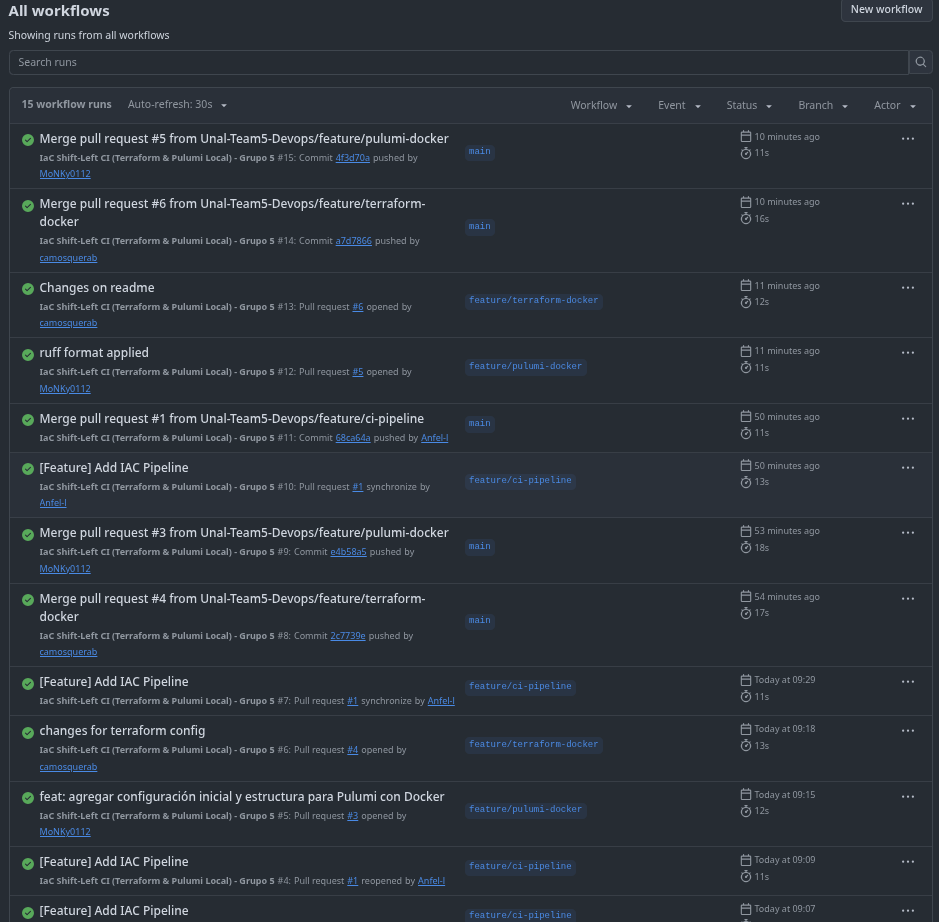
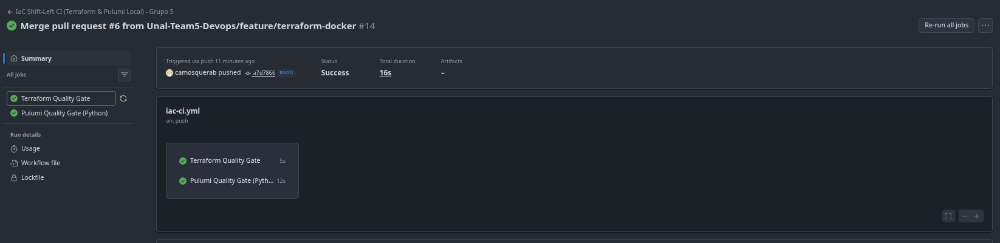
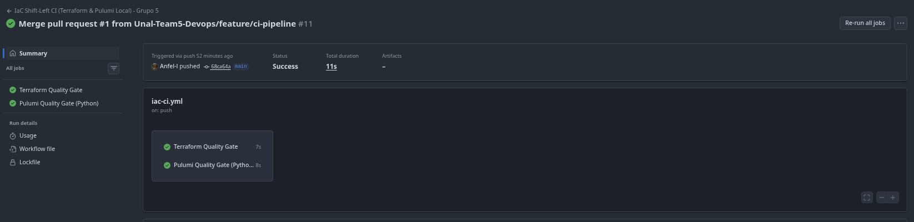
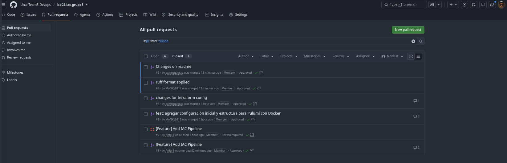

# Informe Comparativo: Terraform vs. Pulumi

**Grupo:** grupo05
**Integrantes:**

- Camilo Alfonso Mosquera Benavides - R1 (Terraform)
- Jonathan David Moncaleano Angel - R2 (Pulumi)
- Andrés Felipe Lugo Rodríguez - R3 (Platform Lead)

**Entorno de ejecución:** Arch Linux x86_64 (kernel 7.2.9), Docker Engine local,
Terraform con provider `kreuzwerker/docker` v3.0.2, Pulumi 3.270.0 con `pulumi-docker` 4.11.2
sobre Python 3.14.

---

## 7.1 Matriz de Comparación Empírica

| Criterio de Comparación | Terraform (HCL) | Pulumi (Python) | Análisis del Grupo con Evidencia Observada |
|---|---|---|---|
| **1. Curva de aprendizaje y sintaxis** | DSL declarativo especializado | Lenguaje general orientado a objetos | Terraform se configuró más rápido: `terraform init` + `apply` desplegó los 3 recursos sin pasos previos. Pulumi exigió además crear el `venv`, instalar ~20 dependencias de Python, hacer `pulumi login --local`, inicializar el stack y manejar una *passphrase*. Para quien ya sabe Python, la sintaxis de Pulumi resulta familiar, pero el entorno tiene más piezas móviles. |
| **2. Líneas de código efectivas (LOC)** | **104** líneas (5 archivos `.tf`) | **56** líneas (`__main__.py`) | Conteo sin comentarios, líneas en blanco ni docstring. HCL infla el conteo por la estructura en bloques: cada `labels { }` ocupa 4 líneas y las variables con `description`/`type`/`default` ocupan 5. Pulumi lo resuelve con listas y lecturas de config en una línea. A cambio, Pulumi reparte la configuración entre `__main__.py`, `Pulumi.yaml` y `Pulumi.dev.yaml`. |
| **3. Manejo del Estado (State)** | Archivo `terraform.tfstate` | Metadatos del Stack local en `~/.pulumi` | `terraform.tfstate` queda junto al código y es JSON legible: basta abrirlo para ver qué recursos existen. El estado de Pulumi vive fuera del repo (`~/.pulumi`) y está ligado a una *passphrase* que cifra la configuración: sin ella no se puede operar el stack (`passphrase must be set with PULUMI_CONFIG_PASSPHRASE`). Ambos son locales, así que el drift solo puede verificarse en la máquina donde se hizo el despliegue. |
| **4. Validación de variables y tipos** | Bloque `validation { condition = ... }` | Lógica en Python (`if ... raise ValueError`) | Terraform valida antes de tocar la infraestructura (en `plan`/`validate`) con un mensaje declarado (`"El ambiente debe ser 'dev', 'staging' o 'prod'."`) y además tipa las variables (`type = number`). Pulumi valida en tiempo de ejecución del programa: más flexible (cualquier lógica de Python), pero el error aparece como excepción del programa y la validación hay que escribirla a mano. |
| **5. Detección y corrección de Drift** | `terraform plan` | `pulumi preview --refresh` | **Terraform detecta el drift por defecto**: `plan` refresca el estado contra Docker y reportó `docker_container.web has been deleted` → `Plan: 1 to add`. **Pulumi no lo detecta sin `--refresh`**: con el contenedor ya borrado, `pulumi up` respondió `4 unchanged` y conservó el `container_id` antiguo. Solo con `--refresh` vio la eliminación y lo recreó (`+ 1 created, 3 unchanged`). Ver sección 7.2. |
| **6. Multiplicidad y ciclos** | Meta-argumento `count` / `for_each` | Bucle estándar `for` en listas Python | Para 10 réplicas, Terraform usa `count = 10` y `name = "...-${count.index}"`: compacto, pero con reglas propias del lenguaje. En Pulumi es un `for i in range(10):` normal, con toda la expresividad de Python (condicionales, funciones, comprensiones). Para lógica compleja, Pulumi es más legible; para casos simples, ambos son equivalentes. |
| **7. Ecosistema de Linters / Shift-Left** | `terraform fmt`, `validate` | `ruff`, `flake8` | En el pipeline de GitHub Actions el *Quality Gate* de Terraform tardó **5–7 s** y el de Pulumi **8–12 s** (este último incluye instalar `ruff` y `flake8` con `pip`). Terraform trae su formateador y validador integrados; en Pulumi hay que traer linters externos de Python. Todas las ejecuciones visibles del pipeline pasaron en verde, incluido el PR #5, que aplicó `ruff format`. |

---

## 7.2 Evidencias del Experimento de Drift

### Despliegue inicial

Ambas herramientas desplegaron su arquitectura en paralelo en la misma máquina, sin colisión de puertos:

```
$ docker ps
CONTAINER ID   IMAGE          ...   PORTS                    NAMES
40cacd332f19   65645c7bb6a0   ...   127.0.0.1:8090->80/tcp   servidor-web-grupo05-pulumi
a2fa1995781c   65645c7bb6a0   ...   127.0.0.1:8080->80/tcp   servidor-web-grupo05-tf
```

### Drift en Terraform

R3 eliminó el contenedor manualmente, fuera de Terraform:

```
$ docker rm -f servidor-web-grupo05-tf
servidor-web-grupo05-tf
```

`terraform plan` consultó el estado real en Docker y detectó la eliminación:

```
$ terraform plan
docker_network.app_network: Refreshing state... [id=6dbdd215fc75...]
docker_image.nginx: Refreshing state... [id=sha256:65645c7bb6a0...nginx:1.27-alpine]
docker_container.web: Refreshing state... [id=a2fa1995781c...]

Note: Objects have changed outside of Terraform

Terraform detected the following changes made outside of Terraform since the last "terraform apply"
which may have affected this plan:

  # docker_container.web has been deleted
  - resource "docker_container" "web" {
      - id   = "a2fa1995781cf4c8ca35fbcb0af2b20b5642e7e5a7096e312d200c2e2073ebad" -> null
        name = "servidor-web-grupo05-tf"
        # (41 unchanged attributes hidden)
    }

Terraform will perform the following actions:

  # docker_container.web will be created
  + resource "docker_container" "web" {
      + name = "servidor-web-grupo05-tf"
      ...
    }

Plan: 1 to add, 0 to change, 0 to destroy.
```

Al aplicar, Terraform recreó **solo** el contenedor; la red y la imagen no se tocaron:

```
docker_container.web: Creating...
docker_container.web: Creation complete after 0s [id=0a4e7ba04495...]

Apply complete! Resources: 1 added, 0 changed, 0 destroyed.
```

### Drift en Pulumi

Con el contenedor `servidor-web-grupo05-pulumi` eliminado manualmente, un `pulumi up` **sin** `--refresh`
**no detectó** el cambio: confió en su estado guardado y reportó todo sin cambios, conservando el ID del
contenedor que ya no existía:

```
$ pulumi up --yes
Previewing update (dev):
     Type                 Name                  Plan
     pulumi:pulumi:Stack  lab02-iac-pulumi-dev

Resources:
    4 unchanged

Outputs:
    container_id  : "40cacd332f199d4f8ac192db04e05d48084d1984fc4cdb13531334f5da60f13e"
    container_name: "servidor-web-grupo05-pulumi"

$ docker ps
CONTAINER ID   IMAGE          ...   PORTS                    NAMES
0a4e7ba04495   65645c7bb6a0   ...   127.0.0.1:8080->80/tcp   servidor-web-grupo05-tf
```

Con `--refresh`, Pulumi consultó la API de Docker, detectó que el contenedor faltaba y lo recreó:

```
$ pulumi up --yes --refresh
 ~  docker:index:Network network-grupo05 refresh
    docker:index:RemoteImage nginx-image-grupo05
 +  docker:index:Container container-grupo05 create

Updating (dev):
 ~  docker:index:Container container-grupo05 refresh (0.12s)
 +  docker:index:Container container-grupo05 created (0.65s)

Outputs:
  ~ container_id  : "40cacd332f19..." => "a871a71e390c5639faab2d49ec6f0c89aec58c571fdf54581ca9ccf76e288c8e"
    container_name: "servidor-web-grupo05-pulumi"
    service_url   : "http://127.0.0.1:8090"

Resources:
    + 1 created
    3 unchanged
```

### Conclusión del experimento

| | Terraform | Pulumi |
|---|---|---|
| ¿Detecta el drift por defecto? | **Sí**: `plan` y `apply` refrescan el estado siempre | **No**: requiere `--refresh` explícito |
| Reacción | Recrea solo el recurso faltante | Recrea solo el recurso faltante |
| Recursos afectados | 1 añadido, red e imagen intactas | 1 creado, 3 sin cambios |

### Destrucción limpia ($0 residuos)

```
$ terraform destroy -auto-approve
Destroy complete! Resources: 3 destroyed.

$ pulumi destroy --yes
Resources:
    - 4 deleted

$ docker ps
CONTAINER ID   IMAGE     COMMAND   CREATED   STATUS    PORTS     NAMES
```

### Evidencias del pipeline Shift-Left

Ejecuciones del workflow `iac-ci.yml` en Pull Requests y en merges a `main`, todas en verde:



Quality Gates al hacer merge del PR #6 (Terraform: 5 s, Pulumi: 12 s):



Quality Gates al hacer merge del PR #1 (pipeline):



Pull Requests revisados y aprobados por pares antes del merge:



---

## 7.3 Conclusión Arquitectónica

Para una empresa donde todos los desarrolladores dominan Python pero no tienen experiencia en DevOps, elegiríamos
**Pulumi**. El equipo podría describir la infraestructura con un lenguaje, un IDE, unas pruebas unitarias y unos
linters (`ruff`) que ya conoce. En el laboratorio, el programa de Pulumi necesitó casi la mitad de líneas efectivas
que el de Terraform (56 frente a 104), y en una arquitectura de microservicios, donde se repiten patrones para
decenas de servicios, poder usar funciones, clases y bucles nativos de Python reduce duplicación y evita aprender
un DSL nuevo.

Sin embargo, el experimento mostró que Pulumi tiene riesgos operativos que hay que cubrir. Las precauciones
serían: (1) usar siempre `pulumi preview --refresh` / `pulumi up --refresh` (o `refresh: always` en la configuración
del stack), porque sin ello Pulumi no detectó el contenedor borrado; (2) guardar el estado en un backend compartido
(S3, Azure Blob o Pulumi Cloud) en lugar de `~/.pulumi`, y manejar la *passphrase* como secreto del pipeline, no de
forma verbal; (3) fijar versiones exactas en `requirements.txt` y en la versión de Python, porque el entorno virtual
es más frágil que el binario único de Terraform; y (4) mantener el pipeline Shift-Left con `ruff`/`flake8` y añadir
un `pulumi preview` obligatorio en cada Pull Request, junto con ramas protegidas y revisión por pares, para que
la flexibilidad de un lenguaje general no se traduzca en cambios de infraestructura sin control.
